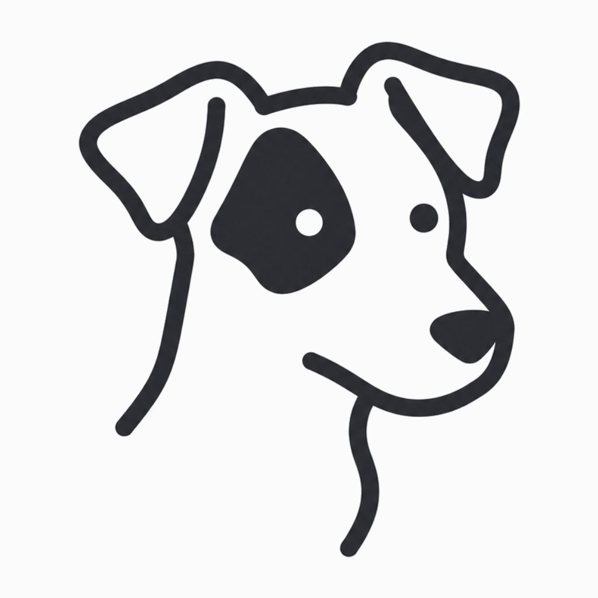

<div align="center"><a name="readme-top"></a>



<h1>Milu</h1>

A desktop harness for a small staff of AI correspondents: one window, several of
them, each with its own desk, memory, and mail.

[![][bun-shield]][bun-link]
[![][electrobun-shield]][electrobun-link]
[![][typescript-shield]][typescript-link]
[![][tailwind-shield]][tailwind-link]<br/>
[![][mcp-shield]][mcp-link]

[Design system](./DESIGN.md) · [Repo conventions](./CLAUDE.md) · [Icon pipeline](./assets/README.md) · [Report Bug][github-issues-link]


</div>

## Quick Start

### Download

The latest build is on **[Releases](https://github.com/mortalYoung/letters/releases)**
(macOS, arm64). Drag it into Applications. The app is unsigned for now, so the
first launch goes through **System Settings → Privacy & Security → Open Anyway**.

### Development

```bash
bun install
bun run dev
```

| Command | What it does |
|---|---|
| `bun run dev` | build the view, then run with watch |
| `bun run dev:view` | Vite watch — rebuild the view on change |
| `bun run build` | build the view, then a production build (`--env=stable`) |
| `bun run build:dev` | the same, on the dev channel |
| `bun run start:log` | dev with the console teed into `.logs/` |
| `bun run typecheck` / `format:check` | the gate: types, then formatting |
| `bun run icons` | regenerate the icon set from `assets/milu.png` |

One Bun process owns everything that matters — the agent runs, the session log, and
the sandbox — and the window is only a view of it. `CLAUDE.md` carries the map;
`src/shared/` holds the types and pure projections both sides share.

## Features

One decision underneath all of it: the agent as correspondent, not chat box.

- **Letter grammar** — delivered rounds, postmark times, a signature line, and one
  channel back to you (`send_message`) instead of a token stream.
- **A staff of correspondents** — several partners in one window, each with its own
  workspace, session log, memory, persona, sandbox mode, model, skills, and MCP
  grants; forks for keeping a variant beside the original.
- **Folded memory** — rounds folded into `memories → scenes → persona`, an idle
  scheduler, and a self-healing cursor.
- **Partner to partner** — `peer { op: "list" | "ask" }`, answers delivered into
  the asker's own conversation, a four-hop cap on an exchange.
- **Kernel-level confinement** — writes outside the workspace and the storage are
  denied by the kernel, a git repository's hooks stay read-only, one wider command
  needs human approval, and the refusal says what it was.
- **Everything as a log** — append-only JSONL sessions, the transcript as a
  projection of that file, any view rebuildable from it.
- **An inspectable desk** — a per-partner dashboard (turns, tokens, TTFT, memory on
  disk), a trajectory drawer, a replies outline, git changes with a diff view, a
  file explorer.
- **Keyboard first** — `/` commands and `@` mentions in one menu grammar, `⌘P` for
  the palette, `⌘⇧P` for who-can-use-what, model·effort as a chip in the input pill.

---

<div align="center">

**Built on** — [pi](https://pi.dev) · [pi-agent-core](https://www.npmjs.com/package/@earendil-works/pi-agent-core) · [pi-ai](https://www.npmjs.com/package/@earendil-works/pi-ai) · [Electrobun](https://electrobun.dev) · [MCP](https://modelcontextprotocol.io) · [CodeMirror](https://codemirror.net/) · [Shiki](https://shiki.style/)

<sub>Made with a fountain pen.</sub>

</div>

[github-issues-link]: https://github.com/mortalYoung/letters/issues
[bun-shield]: https://img.shields.io/badge/Bun-1.4-fbf0df?labelColor=black&logo=bun&logoColor=white&style=flat-square
[bun-link]: https://bun.sh
[electrobun-shield]: https://img.shields.io/badge/Electrobun-2.0.1-2f6f9f?labelColor=black&style=flat-square
[electrobun-link]: https://electrobun.dev
[typescript-shield]: https://img.shields.io/badge/TypeScript-7-3178c6?labelColor=black&logo=typescript&logoColor=white&style=flat-square
[typescript-link]: https://www.typescriptlang.org
[tailwind-shield]: https://img.shields.io/badge/Tailwind-v4-38bdf8?labelColor=black&logo=tailwindcss&logoColor=white&style=flat-square
[tailwind-link]: https://tailwindcss.com
[mcp-shield]: https://img.shields.io/badge/MCP-stdio-2f6f9f?labelColor=black&style=flat-square
[mcp-link]: https://modelcontextprotocol.io
