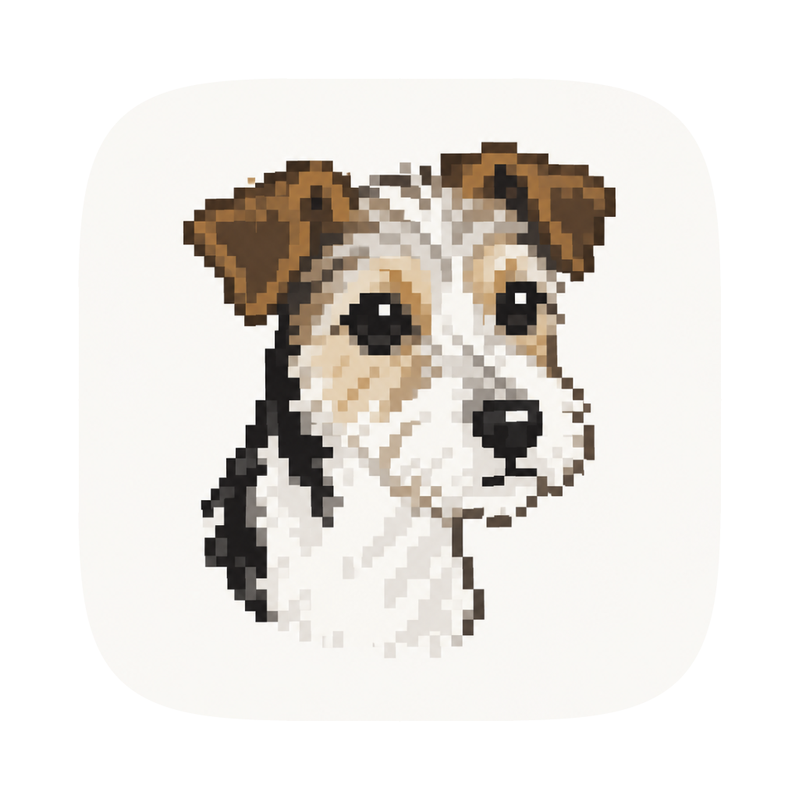

<div align="center"><a name="readme-top"></a>



<h1>Milu</h1>

An agent harness with a local core — one IPC protocol, one desktop shell.

You pick a chat. It reads files, runs commands, and replies. Everything runs on your machine:
no account, no server of ours, no telemetry, keys and data on disk.

[![][bun-shield]][bun-link]
[![][electron-shield]][electron-link]
[![][typescript-shield]][typescript-link]
[![][tailwind-shield]][tailwind-link]<br/>
[![][mcp-shield]][mcp-link]

[Report Bug][github-issues-link]


</div>

> **Rebuild in progress.** The desktop shell runs; the web end is deferred. The previous
> implementation — 303 commits, one package, Electrobun — is kept whole at tag `archive/v1`
> and branch `master`.

## Quick Start

No build is shipped yet; the sources are the app.

### Development

```bash
bun install
bun run dev             # Vite + Electron, main/preload bundled first
bun run build           # renderer/dist and dist-electron
bun run start           # Electron against the built renderer
bun run site            # the homepage at http://127.0.0.1:4173
bun run site:deploy     # publish site/ with gh-pages
bun run check           # tsc + oxlint + oxfmt + the package boundaries
```

The first deploy needs Pages enabled once: **Settings → Pages → Deploy from a branch → `gh-pages` / (root)**.

There is no test suite by design; behavior is verified by hand.

## Features

- **Less is more** — keep everything just enough: a minimal prompt, a simple interface,
  fewer tools.
- **Optional workspace** — run a chat with no workspace at all for statistics or other
  global work.
- **Memory** — each chat keeps its own memory, split into facts, issues and decisions.
  Keep talking and it grows into scenes, SOPs and a persona that sounds like you.
- **Long-term chat** — memory and cache hits wired in, so one chat per partner always
  works in context.
- **Keyboard** — `⌘P` opens a palette over chats, files and access: switch chat, jump to a
  file, or give a chat skills and MCP servers.
- **Permission** — a hard ceiling on the agent: a seatbelt sandbox confines what it can
  write, a wider mode needs a human to say yes, and `rm` only runs after the move to the
  trash has failed.
- **Local** — everything runs on your machine: no account, no server, no telemetry, and
  your keys and data stay on disk.
- **Everything as a log** — sessions are append-only, and every view is built from them:
  transcript, trajectory, replies, git diff, explorer.

## Why not

- **Claude Code** — a nice model under a bad harness: a swollen prompt, 80% of its
  functions useless for normal scenes, and — the important part — no source to read.
- **Codex** — an expert at making things complex, then persuading you that's the point. An
  acquired taste, apparently compulsory.
- **Kimi Code** — a bad UI swollen with functions. Less is More? Never heard of it.
- **ZCode** — Schrödinger's _open-source_: you can't tell without opening the box — and GLM
  is in there either way.
- **dsh** — DeepSeek Harness: a talented harness — just don't hand it to a non-programmer.

---

<div align="center">

**Built on** — [pi](https://pi.dev) · [pi-agent-core](https://www.npmjs.com/package/@earendil-works/pi-agent-core) · [pi-ai](https://www.npmjs.com/package/@earendil-works/pi-ai) · [Electron](https://www.electronjs.org) · [MCP](https://modelcontextprotocol.io) · [Shiki](https://shiki.style/)

<sub>Made with a fountain pen.</sub>

</div>

[github-issues-link]: https://github.com/mortalYoung/Milu/issues
[bun-shield]: https://img.shields.io/badge/Bun-1.4-fbf0df?labelColor=black&logo=bun&logoColor=white&style=flat-square
[bun-link]: https://bun.sh
[electron-shield]: https://img.shields.io/badge/Electron-44-2f6f9f?labelColor=black&logo=electron&logoColor=white&style=flat-square
[electron-link]: https://www.electronjs.org
[typescript-shield]: https://img.shields.io/badge/TypeScript-7-3178c6?labelColor=black&logo=typescript&logoColor=white&style=flat-square
[typescript-link]: https://www.typescriptlang.org
[tailwind-shield]: https://img.shields.io/badge/Tailwind-v4-38bdf8?labelColor=black&logo=tailwindcss&logoColor=white&style=flat-square
[tailwind-link]: https://tailwindcss.com
[mcp-shield]: https://img.shields.io/badge/MCP-stdio-2f6f9f?labelColor=black&style=flat-square
[mcp-link]: https://modelcontextprotocol.io
